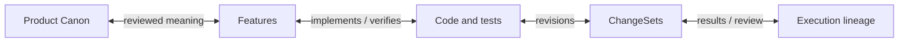

# Recorded code context

Ask Lode “Why is this code here?”, “What changed around this recorded request?”,
or “Show the source and document differences for this work.” Lode can follow the
existing graph from a source or a work/direction/review record. You do not need
to write JSON, create an Event, start a Run, commit, bind a Session or save another
record just to investigate.

The existing detailed project query includes a read-only `contextLineage` view.
The same content reaches typed MCP, readable CLI output and Graph Explorer:

```powershell
node scripts/lode.mjs graph-query "<project-directory>" --paths src/action.mjs --details
node scripts/graph-explorer.mjs --root "<project-directory>" --query src/action.mjs
```

## Follow records, not an invented history

The terminal starts with the selected directed connections and readable records,
then shows exact available source/Canon changes, reasons and gaps. Its numbered
labels are local display references, not new IDs. Cycles, parallel edges and
multiple parents stay separate; they are not forced into a tree. No Run or World
is required just to read available evidence.

Add `--diagnostics` to `graph-query` for the complete selected result, or `--json`
for unchanged machine-readable data. Narrow/no-color/redirected output wraps
without dropping text. Terminal widths are a conservative CJK/emoji fallback,
not font measurements. Original text and diff lines have a `|` source prefix;
control characters are displayed inertly, and embedded newlines cannot create
outer status rows. Canon comparisons show changed descriptions, status and
relationships even when the main statement stays the same.

Work evidence is HEAD-authored P3 material, not automatically a verbatim user
message. ProjectDirection is caller-conveyed user direction, not proof of Host
transcript capture. Titles, judgments, conditions, cancellations, pending work and
unknowns retain that source. Work links, review references and source citations
use their existing identities. Matching text, Session, timestamp, path or commit
does not merge records or prove that one request caused a change.

An exact source citation means “this record mentions these bytes.” A recorded
work/result/review relationship is shown at its recorded level. Neither graph
adjacency nor a citation is silently relabeled as execution or fulfillment. A
proposal-only record can remain useful even when no outcome was recorded.

## Compare the right versions

A ChangeSet supplies its exact recorded snapshot pair. Those versions are shown
separately from current disk bytes. They are not automatically “before the user
request” and “after fulfilling it”: parallel work can be mixed into the snapshot.
An explicit work chain can also expose two exact cited versions, but without
source-role evidence they are labelled version A and version B, not request
boundaries. A later edit never replaces the recorded after version.

File/Symbol/Test revision IDs are preserved. A changed SymbolRevision does not
prove that its declaration changed: a different function elsewhere in the file
can change the ID. Each exact source version is analyzed independently using the
existing bounded analyzer. Declaration text, comment-text-only differences,
line movement, unmatched declarations and unknown boundaries are distinct.
Same-line statements, default-parameter ambiguity, unsupported syntax/languages,
duplicate names and truncated analysis reduce precision. These are observations
of declaration/line text, not a full AST, exact body proof, rename lineage or
behavioral equivalence judgment.

Before/after code and document excerpts are readable without opening JSON.
Excerpts prioritize separated changed regions and surrounding context within
the shared per-side line/UTF-8 byte budget. Each region retains its own original
line numbers; separated text is never presented as one contiguous source range.
Omitted lines and regions remain explicit. Unchanged context is not individually
claimed as edits. Canon comparisons use exact retained model originals and
their actual recorded review rationale, not structural graph ID differences.
Known original record fields have readable bodies; raw originals, unknown fields,
IDs, digests and machine-readable output remain available as diagnostics.

## Missing evidence is a gap, not a new ritual

The reader first checks exact local source bytes. Where available, bounded local
Git path history and raw blobs can recover a cited digest. No textconv, external
diff, lazy fetch, network, hook, Git mutation or automatic parser installation is
used. A matching blob is a byte location, not a unique commit, Run owner or reason.
Existing source-reference byte bounds remain; local history reads inspect at most
16 path commits and 24 commands per query. A recorded ChangeSet may inspect a
bounded page of up to 128 existing snapshots for its exact pair. When an exact
World ID was actually recorded, it is read directly and its Source/Graph pair
is verified first. Legacy pair-only records do not acquire an invented World ID;
an exhausted scan is distinguished from an absent match. This does not solve
all legacy history beyond that bounded window or introduce a new writer/store.
Any omitted or unavailable portion stays unknown.

Non-Git, Run-free, absent/stale World and missing original-source histories still
permit available context and normal work. The view does not collect transcripts,
manufacture reasons, create a before/after store, promote Canon, write recovery
direction, replay effects or infer completion. Source comparison is re-observed
even when the base graph can be reused. No per-click model call or persistent
event-management system is required.

See [graph discovery](graph-discovery.md), [Graph Explorer](graph-explorer.md) and
[temporal provenance](temporal-provenance.md).

### Exact retained source addresses

A recorded bundle key, source path and digest can be read directly through the original bundle verifier without enumerating unrelated bundles. An exact bundle request preserves that physical source: a missing, mismatched or unreadable bundle remains unavailable even when current bytes match. Ordinary source-by-digest lookup may still use matching current bytes, recorded bundle hints, bounded retained lookup and local Git history. Readers do not collect new source or write records.

## Exact path-scoped historical diff

`head_graph_lineage_diff` optionally accepts `scope_paths` and an opaque `cursor`; CLI `graph-lineage-diff --from <id> --to <id> --path <exact-relative-path>` exposes a single-path selection. Omit scope/cursor for the unchanged version0.2 whole-endpoint projection. Scoped/page projections use version0.3, keep exact from/to hashes and query/order in their cursor, and never follow a moving current pointer. Resend the same endpoints and scope on each page.

Every endpoint is still fully read and verified. Node changes select exact paths, including removed files. Edge changes include edges incident to a selected node in either endpoint or bearing that exact evidence path, including cross-path edges. Possible moves require both old and new paths in scope and remain evidence rather than identity proof. Root source context changes remain disclosed independently of selected records. Counts are exact within this scope; global counts are marked not-computed rather than zero. OmittedCount counts all items outside this page, while page.remaining counts only undisplayed subsequent items. No chunk-only verification or false unchanged/deletion claim is made. Locale-equivalent move keys preserve original removed-major/added-minor order; digest grouping and k-way merge avoid materializing or iterating all matching pairs for a bounded page.

<a id="graph-and-record-examples"></a>

## Graph and records

Graph Explorer's `graph-explorer <project-directory>` CLI creates a read-only
HTML snapshot of the target project's evidence, not the plugin installation.
Ask the agent to run that existing CLI; there is no dedicated HTML-export MCP
tool. It is not a live view. See [Graph Explorer](graph-explorer.md) for
search, explicit history and sharing options.

For new project information, Lode uses bounded `lode_project_graph` discovery
first, or reuses sufficient results from the same basis. Work and Product views
reference the same original records. The result keeps revision, provenance,
coverage and candidate/rejection state, including intact history. Missing or
failed layers lead to original-source inspection without requiring whole-World
currentness, Product approval, Run/Capsule or ArcadeDB. Empty partial results do
not prove absence; effects separately recheck current sources and authority.
The query does not generate a new artifact per read. See
[Graph discovery and independent Sessions](graph-discovery.md).


A `GraphSnapshot` is the immutable, content-addressed evidence graph embedded in
one verified Repository World Model. It is not a graph UI screenshot, database
backup, or mutable latest-node collection. The same verified inputs produce the
same `graphSnapshotId`; semantic changes create a new snapshot with explicit
ancestry.

`lode_world_model` verifies that complete model and current repository, then
returns a bounded status projection instead of transporting the full snapshot.
Counts, IDs, digests, samples, and omission metadata stay available; deeper
inspection uses the bounded graph, history, runtime, and semantic query tools.
This keeps MCP responses small without skipping any freshness or digest check.



Raw prompts stay outside this graph. Product meaning enters only through
reviewed Canon. General discovery may show labelled candidates/rejected records
without promoting them; they remain excluded from Canon Context compilation.

Common Observations keep their exact descriptor, receipt, and derivation
lineage in the same temporal graph. A ProductHypothesis may point to an exact
Observation, but that edge remains evidence for a hypothesis rather than a
promotion of measured data into product truth. If Observation storage is
damaged, only that graph layer is reported unavailable; unrelated product work
continues.

Delivery observations add practical operational genealogy without turning the
graph into a deployment controller. Each Host event names an environment,
target, artifact revision, explicit sequence, and predecessor. The read-only
current-state card shows uniform, mixed, or unknown observed state; failed
attempts do not erase the last applied revision, rollback remains in history,
and unobserved targets are never guessed successful. Exact retained source
revisions receive verified `AT_REVISION` links; declared strings stay visibly
unverified.

Policy genealogy stays equally explicit. A proposed create, revision, or
retirement is P3 evidence until the user accepts that exact candidate. The
accepted decision points to the resulting Product Model revision and to the
matching current Policy revision, even after an unrelated Policy is added.
General graph discovery retains an unreviewed Policy candidate's original state;
legacy governed traversal can exclude it and Canon compilation does not promote it.

Source relations are structural evidence, not product meaning. The default
heuristic import/call graph remains available, while an optional provider-neutral
language-AST adapter may add separately labeled, exact-file-bound evidence. One
source never silently overwrites the other, and neither can approve a decision.

### Graph versus record

Records feed the graph and its projections in this direction:

```text
P1 Product Canon + observed source + verified P2/P3 records
  → P4 Repository World Model containing a recoverable GraphSnapshot
      → replaceable graph materialization: local JSON / optional ArcadeDB
      → replaceable human projection: Markdown
```

The graph owns navigation, not meaning or recovery direction. Deleting GraphDB
or generated Markdown must leave Product Canon, Session/Run recovery, and review
lineage intact. A stale, tampered, or semantically divergent projection fails
closed instead of redefining the graph.

### Query the graph

```powershell
lode-agent world-status C:\path\to\project
lode-agent world-temporal C:\path\to\project `
  --query "<Feature, symbol, path, ChangeSet, or ReviewDecision>" `
  --depth 3 --limit 100 --edge-limit 200
lode-agent graph-lineage-status C:\path\to\project
lode-agent graph-lineage-trace C:\path\to\project --anchor <exact-node-id>
lode-agent graph-lineage-diff C:\path\to\project `
  --from <older-world-model-id> --to <newer-world-model-id>
lode-agent context-preview C:\path\to\project --task "<task>" --budget 32768
```

Traversal returns snapshot, query, and result identities plus inclusion,
exclusion, and truncation reasons. Embedded, local JSON, and activated ArcadeDB
backends must preserve the same semantic result.

The lineage commands reuse retained content-addressed World snapshots and do
not create another history stream. Their Hot/Warm/Cold status, trace, execution
overlay, and diff are non-persisted P4 views. An exact-content file move is only
reported as a possible move; semantic identity is never asserted automatically.
