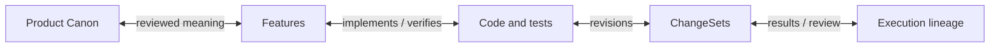

# 기록된 코드 맥락

> 영어 원문: [context-lineage.md](../context-lineage.md)

Lode에 “이 코드는 왜 이렇게 되어 있어?”, “이 요청 기록과 연결된 변경은 뭐야?”,
“이 작업의 코드와 문서 전후를 보여 줘”라고 요청하세요. 소스나 기존 작업·방향·
검토 기록에서 그래프를 따라갈 수 있습니다. 조사하려고 JSON을 쓰거나 Event를
만들고, Run을 시작하고, 커밋하고, Session을 바인딩하거나 새 기록을 저장할 필요는 없습니다.

기존 상세 프로젝트 조회에 읽기 전용 `contextLineage` 보기가 포함됩니다.
같은 내용을 typed MCP, 읽기 쉬운 CLI 출력, Graph Explorer에서 확인합니다.

```powershell
node scripts/lode.mjs graph-query "<project-directory>" --paths src/action.mjs --details
node scripts/graph-explorer.mjs --root "<project-directory>" --query src/action.mjs
```

## 없는 이력을 만들지 않고 기록 따라가기

터미널에서는 선택된 방향성 연결과 읽기 쉬운 기록을 먼저 보여주고, 가용한 소스·
Canon 전후와 기록된 사유·결손을 이어서 표시합니다. 번호는 화면 안의 참조이며
새 ID가 아닙니다. 순환·평행 간선·다중 부모를 가짜 트리로 합치지 않습니다.
가용 근거를 읽으려고 Run이나 World를 먼저 만들 필요도 없습니다.

`graph-query`에 `--diagnostics`를 붙이면 선택 결과 전체를, `--json`을 붙이면
변경하지 않은 기계용 데이터를 볼 수 있습니다. 좁은 폭·무색상·리다이렉트 출력은
본문을 버리지 않고 줄바꿈합니다. 한글·이모지 폭은 보수적인 대체 계산이며 실제
글꼴 측정은 아닙니다. 원문·diff 각 줄은 `|` 출처 표시 안에 두고 제어 문자를
비활성 텍스트로 보여주므로 본문의 줄바꿈으로 바깥 상태 행을 만들 수 없습니다.
Canon 대표 문장이 같아도 바뀐 설명·상태·관계를 따로 전후 표시합니다.

작업 근거는 HEAD가 남긴 P3 기록이지 자동으로 수집한 사용자 발언 원문이 아닙니다.
ProjectDirection도 호출자가 전달한 사용자 방향이며 Host 대화 수집의 증거가 아닙니다.
제목·판단·조건·취소·남은 일·불확실성을 해당 출처와 함께 유지합니다. 작업 연결·검토
참조·소스 인용은 기존 식별자를 사용합니다. 문장·Session·시각·경로·커밋이 같다는
이유로 기록을 합치거나 한 요청이 변경의 원인이라고 판정하지 않습니다.

정확한 소스 인용은 “이 기록이 이 바이트를 언급했다”는 뜻입니다. 작업·결과·검토의
연결은 기록된 수준으로 보여줍니다. 그래프 이웃이나 인용을 실행·반영 완료로 바꾸지
않습니다. 제안만 있는 기록은 결과가 없어도 탐색에 쓸 수 있습니다.

## 올바른 버전 비교하기

ChangeSet은 정확한 당시 스냅샷 쌍을 제공합니다. 이를 현재 디스크 바이트와 분리해
보여줍니다. 병렬 변경이 섞일 수 있으므로 자동으로 “사용자 요청 전”과 “반영 후”라고
부르지 않습니다. 명시적 작업 연결에 인용된 두 소스도 비교할 수 있지만, 소스의 역할을
입증하는 근거가 없으면 요청 경계가 아니라 버전 A와 버전 B로 표시합니다.
나중에 바뀐 현재 코드로 당시 after를 대체하지 않습니다.

File/Symbol/Test revision ID를 보존합니다. 같은 파일의 다른 함수가 바뀌어도
SymbolRevision ID가 달라질 수 있으므로 ID 변경을 선언 변경으로 해석하지 않습니다.
각각의 정확한 소스를 기존 제한 범위 분석기로 따로 분석합니다. 선언 텍스트 변경·
주석 텍스트만의 차이·줄 이동·대응하지 않는 선언·경계 불확실을 구분합니다. 같은 줄의
다른 문장·기본 인자 모호성·미지원 문법이나 언어·동명 선언·분석 잘림은 정밀도를
낮춥니다. 이는 선언·줄 텍스트 관측이지 완전한 AST, 정확한 본문 증명, rename 계보나
동작 동등성 판정이 아닙니다.

JSON을 열지 않아도 코드·문서 전후 구간을 읽을 수 있습니다. 떨어진 변경 구간과
주변 문맥을 각 버전의 공통 줄 수·UTF-8 바이트 예산 안에서 우선 배분합니다.
각 구간은 원래 줄 번호를 유지하며 떨어진 원문을 연속 구간처럼 표시하지 않습니다.
누락된 줄·구간을 명시하고 동일한 문맥까지 수정됐다고 주장하지 않습니다.
Canon 비교는 정확한 보존 모델 원문과 실제 검토 사유를 사용하며 그래프
구조 ID 차이만으로 이유를 설명하지 않습니다. 알려진 원본 필드는 읽기 쉬운 본문으로
표시하고, 원본 전체·알 수 없는 필드·ID·digest·기계용 출력은 진단으로 유지합니다.

## 근거 결손은 새 절차를 요구하지 않습니다

우선 정확한 로컬 소스 바이트를 확인합니다. 가능하면 제한된 로컬 Git 경로 이력과
raw blob에서 인용한 digest를 복구합니다. textconv·외부 diff·lazy fetch·네트워크·
hook·Git 변경·자동 parser 설치는 사용하지 않습니다. 같은 blob은 바이트가 있는
위치이지 유일한 커밋·Run 소유자·이유의 증거가 아닙니다. 기존 소스 참조 바이트
한도를 유지하며, 한 조회에서 경로 커밋 최대 16개와 명령 24회까지 확인합니다.
기록된 ChangeSet의 정확한 쌍을 찾기 위해 기존 스냅샷 최대 128개의 제한된 페이지를
확인할 수 있습니다. 정확한 World ID가 실제 기록된 경우에는 그 ID를 먼저 직접 읽고
Source/Graph 쌍을 검증합니다. 쌍만 있는 과거 기록에 World ID를 추정해 넣지 않으며,
탐색 예산 소진과 일치 항목 부재를 구분합니다. 과거 쌍 기반 기록의 128개 밖 조회를
모두 해결하거나 새 writer·저장소를 만드는 변경은 아닙니다. 누락은 모름으로 남깁니다.

Git이나 Run이 없고, World가 없거나 오래됐거나, 과거 소스가 없어도 가용 맥락을 보고
일반 작업을 계속할 수 있습니다. 대화를 수집하거나 이유·완료를 만들어 내지 않으며,
전후 저장소 생성·Canon 승격·복구 방향 기록·효과 재실행도 하지 않습니다. 기본 그래프를
재사용할 수 있어도 소스 비교 근거는 다시 확인합니다. 매 클릭 모델 호출이나 영구적인
이벤트 관리 시스템은 필요하지 않습니다.

[그래프 탐색](graph-discovery.md), [Graph Explorer](graph-explorer.md),
[시간 출처](temporal-provenance.md)도 참고하세요.

### 정확한 보존 원문 주소

기록된 bundle key·소스 경로·digest가 있으면 관련 없는 bundle 목록을 열거하지 않고 기존 원문 검증기로 직접 읽습니다. 특정 bundle을 요청한 경우에는 현재 파일의 바이트가 같더라도 누락·불일치·읽기 실패를 그 원문으로 대체하지 않습니다. 일반 source-by-digest 조회는 일치하는 현재 바이트, 기록된 bundle hint, 제한된 보존 자료와 로컬 Git 이력을 계속 사용할 수 있습니다. reader는 새 소스를 수집하거나 기록을 쓰지 않습니다.

## 정확한 경로 범위의 과거 diff

`head_graph_lineage_diff`는 선택적으로 `scope_paths`와 opaque `cursor`를 받습니다. CLI는 `graph-lineage-diff --from <id> --to <id> --path <exact-relative-path>`로 단일 경로를 선택합니다. scope/cursor를 생략하면 기존 version0.2 전체 endpoint 투영 그대로이며, 선택/페이지 결과는version0.3입니다. cursor는 from/to hash·범위·정렬에 묶이며 current pointer가 움직여도 바뀌지 않습니다. 다음 페이지에도 같은 endpoint와 범위를 전달합니다.

각 endpoint는 전체를 읽고 검증합니다. 노드 변경은 제거된 파일을 포함해 정확한 경로를 선택합니다. 관계 변경은 전후 어느 쪽이든 선택된 노드에 닿거나 정확한 evidence path를 가진 관계를 포함하므로 cross-path edge도 보존합니다. 이동 후보는 전후 경로 모두 범위 안에 있어야 하며 신원 증명이 아닙니다. root source 문맥 변화는 선택 레코드와 별도로 표시합니다. count는 선택 범위 내 정확한 값이고 전체 count는0 대신 not-computed로 표시합니다. omittedCount는 이번 페이지 밖 전체 항목, page.remaining은 뒤에 남은 항목입니다. chunk만 읽고 전체 검증했다고 하거나 허위 무변경/삭제를 선언하지 않습니다. locale상 같은 이동 키는 원래 removed-major/added-minor 순서를 보존하며 digest 그룹과 k-way merge로 bounded page를 만들 때 모든 일치 쌍을 만들거나 순회하지 않습니다.

<a id="graph-and-record-examples"></a>

## 그래프와 기록

Graph Explorer의 `graph-explorer <project-directory>` CLI는 플러그인 설치 폴더가
아닌 대상 프로젝트의 근거를 읽기 전용 HTML 스냅샷으로 만듭니다. 에이전트에게 기존
CLI 실행을 요청할 수 있으며, 별도 HTML 내보내기 MCP 도구는 없습니다. 실시간 화면은
아닙니다. 검색·명시적 과거 기록·공유 옵션은 [Graph Explorer](graph-explorer.md)를 참고하세요.

새 프로젝트 정보는 `lode_project_graph`의 범위가 정해진 관계 조회나 충분한 동일
기준 결과의 재사용으로 찾습니다. 작업과 Product 관점은 같은 원본을 참조하며,
온전한 과거 자료의 리비전, 출처, 확인 범위와 후보·거절 상태도 유지합니다.
없거나 실패한 층은 원본 탐색으로 보완하며 전체 World의 최신성, Product 승인,
Run/Capsule이나 ArcadeDB를 시작 조건으로 삼지 않습니다. 부분 결과가 비어 있어도
사실 부재로 단정하지 않습니다. 실제 효과는 현재 원본과 권한을 다시 확인하며
조회마다 새 기록을 만들지 않습니다.
[그래프 탐색과 독립 Session](graph-discovery.md)을 참고하세요.


`GraphSnapshot`은 검증된 하나의 Repository World Model에 포함된 변경 불가능한
콘텐츠 주소 기반 증거 그래프입니다. 그래프 UI의 스크린샷, 데이터베이스
백업, 변경 가능한 최신 노드 집합이 아닙니다. 동일한 검증 입력은 동일한
`graphSnapshotId`를 생성하고, 의미가 달라지면 명시적인 계보를 가진 새
스냅샷이 생성됩니다.

`lode_world_model`은 전체 모델과 현재 저장소를 빠짐없이 검증한 뒤, 전체
스냅샷 대신 크기가 제한된 상태 조회 결과를 반환합니다. 개수, ID, 다이제스트,
표본과 생략 정보는 유지합니다. 더 자세한 내용은 범위가 제한된 그래프·이력·
런타임·의미 질의 도구로 확인합니다. 최신성이나 다이제스트 계산을 생략하지 않고
MCP 응답 크기를 줄입니다.



원시 프롬프트는 이 그래프 밖에 남습니다. 제품 의미는 검토된 Canon
아티팩트를 통해서만 들어옵니다. 일반 탐색은 후보·거절 기록의 원래 상태를
표시하면서 읽을 수 있으며 Canon Context 컴파일에서 승격하지 않습니다.

공통 Observation의 정확한 설명자, 수집 영수증과 도출 계보도 같은 시계열 그래프에
들어갑니다. ProductHypothesis가 정확한 Observation을 가리켜도 그 관계는 가설의
근거로만 남으며 측정 데이터를 제품의 확정 사실로 승격하지 않습니다.
Observation 저장소가 손상되면 해당 그래프 층만 사용할 수 없다고 표시하고,
관련 없는 제품 작업은 계속할 수 있습니다.

Delivery observation은 배포를 제어하지 않고 운영 이력을 기록합니다. 각 Host
이벤트는 환경, 대상, 산출물 리비전, 명시적 순서와 이전 항목을 지정합니다.
읽기 전용 상태 카드는 관측된 상태가 동일한지, 섞였는지, 미확인인지를 보여줍니다.
실패한 시도가 마지막 적용 리비전을 지우지는 않으며 롤백도 이력에 남습니다.
관측하지 않은 대상은 성공으로 추측하지 않습니다. 보존된 정확한 소스 리비전에는
검증된 `AT_REVISION` 연결을 만들고 단순 선언 문자열은 미검증 상태로 표시합니다.

Policy의 생성·수정·종료 제안도 사용자가 정확한 후보를 승인하기 전까지 P3 근거로
남습니다. 승인된 결정은 그 결과로 생긴 Product Model 리비전과 해당 Policy의
현재 리비전을 가리키며, 이후 다른 Policy가 추가돼도 연결을 유지합니다.
일반 그래프 탐색은 검토되지 않은 Policy 후보의 원래 상태도 보존합니다.
이전 관리형 탐색에서는 이를 제외할 수 있고, Canon 컴파일은 후보를 승격하지 않습니다.

소스 관계는 구조를 보여주는 근거이며 제품 의미를 결정하지 않습니다. 기본 휴리스틱
import/call 그래프를 유지하면서, 선택적인 공급자 중립 언어 AST 어댑터가 현재
파일 매니페스트에 결속된 근거를 별도 표시로 추가할 수 있습니다. 어느 근거도
다른 근거를 덮어쓰거나 결정을 승인하지 않습니다.

### 그래프와 기록의 경계

기록에서 그래프와 조회 결과를 만드는 방향은 다음과 같습니다.

```text
P1 Product Canon + observed source + verified P2/P3 records
  → P4 Repository World Model containing a recoverable GraphSnapshot
      → replaceable graph materialization: local JSON / optional ArcadeDB
      → replaceable human projection: Markdown
```

그래프는 탐색을 소유하지만 의미나 복구 방향을 소유하지 않습니다. GraphDB나
생성된 Markdown을 삭제해도 Product Canon, Session/Run 복구, 검토 계보는
남아야 합니다. 오래되거나 변조되거나 의미적으로 달라진 프로젝션은 그래프를
재정의하지 않고 실패 폐쇄됩니다.

### 그래프 질의

```powershell
lode-agent world-status C:\path\to\project
lode-agent world-temporal C:\path\to\project `
  --query "<Feature, symbol, path, ChangeSet, or ReviewDecision>" `
  --depth 3 --limit 100 --edge-limit 200
lode-agent graph-lineage-status C:\path\to\project
lode-agent graph-lineage-trace C:\path\to\project --anchor <exact-node-id>
lode-agent graph-lineage-diff C:\path\to\project `
  --from <older-world-model-id> --to <newer-world-model-id>
lode-agent context-preview C:\path\to\project --task "<task>" --budget 32768
```

탐색 결과는 스냅샷, 질의, 결과 식별자와 포함·제외·잘림 이유를 함께
반환합니다. 내장 그래프, local JSON, 활성화된 ArcadeDB 백엔드는 동일한
의미 결과를 보존해야 합니다.

계보 명령은 보존된 콘텐츠 주소 기반 World 스냅샷을 재사용하며 별도 이력을 만들지
않습니다. Hot/Warm/Cold 상태, 추적, 실행 오버레이와 차이 조회는 저장하지 않는
P4 뷰입니다. 내용이 정확히 같은 파일 이동도 가능한 이동으로만 보고하며,
의미적 동일성을 자동으로 단정하지 않습니다.
